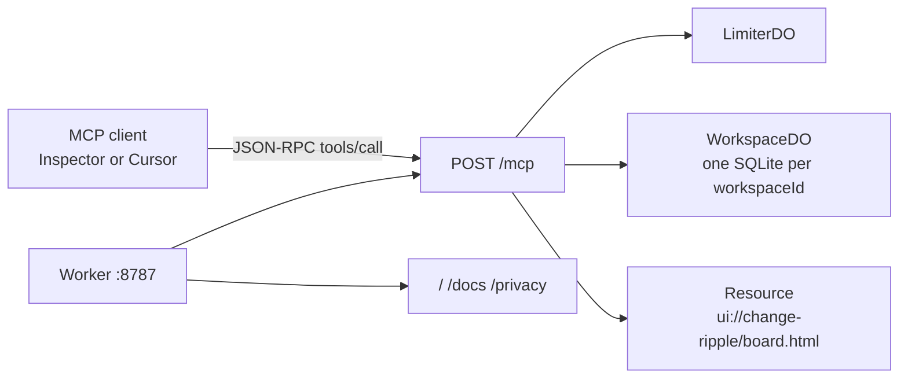

# How Change Ripple works

This is the map of the running app: what MCP is here, what a workspace is, what each tool does, and how to drive it with a local MCP client (no Claude account required).

Keep `npm run dev` running. Endpoint: `http://127.0.0.1:8787/mcp`.

## The pieces, in this repo

| Word | What it is here | Where |
|---|---|---|
| **Worker / HTTP server** | A Cloudflare Worker. Ordinary pages (`/`, `/docs`, `/privacy`) plus one MCP endpoint. | `src/server/index.ts` |
| **MCP server** | The JSON-RPC app behind `POST /mcp`. Name `change-ripple`. Lists tools and one UI resource. | `src/server/mcp.ts` |
| **Tool** | A named function the client can call (`start_demo_workspace`, `save_drafts`, …). | same |
| **Resource** | A fetchable document. We have one: the review board HTML. | `ui://change-ripple/board.html` |
| **App / board** | That HTML, bundled from `src/ui/`. Claude would show it in an iframe. Inspector shows it as a resource you can read, not as a live Claude widget. | `src/ui/main.ts` |
| **Workspace** | One isolated sandbox of the Maison Aube sample. ID like `ws_…`. Anyone holding the ID can use it. Expires after 7 days. | Durable Object `WorkspaceDO` |
| **Limiter** | Caps how many workspaces can be created per UTC day (500 in production, overridable). | `LimiterDO` |



A **client** (Inspector, Cursor, our Vitest tests) is not the Worker. It only sends `tools/list`, `tools/call`, `resources/read`.

## Workspace

`start_demo_workspace` copies `data/maison-aube.json` into a new Durable Object:

- 1 brand, 1 product, 1 campaign
- 1 claim: `hydration_duration`, currently **48** hours; the only approved new value is **24**
- 6 markets × 4 channels = **24 assets** (e.g. `DE-product_page`)
- a random `workspaceId` (`ws_` + 22 characters)
- a random `reviewToken` (only returned later, in `_meta` of `open_review_board`)

Every later tool takes `workspaceId` except `start_demo_workspace`. If the ID is unknown or expired, you get `WORKSPACE_NOT_FOUND` and nothing is stored.

Copy the `workspaceId` out of the first tool result and paste it into every following call.

## Tools

Visibility is a **hint for Claude**. Inspector and Cursor will still list app-only tools. Call them anyway locally; that is useful. In Claude they are supposed to be callable only from the board.

| Tool | Changes data? | Typical caller | What you should see |
|---|---|---|---|
| `start_demo_workspace` | Yes: creates sandbox | you / model | `workspaceId`, 24 assets, claim 48 h |
| `preview_claim_change` | No | model | 20 of 24 affected; 2 by text scan only |
| `open_change` | Yes: marks 20 assets `stale` | model | `alreadyOpen: false` the first time |
| `get_drafting_brief` | No | model | current text, limits, footnotes, findings |
| `save_drafts` | Yes: new versions + checks | model | `pending_review` or `draft_failed` |
| `open_review_board` | No | model or board | items + `_meta.reviewToken` |
| `get_release_status` | No | model or board | `NO_OPEN_CHANGE` / `BLOCKED` / `WAITING` / `READY` |
| `save_reviewer_edit` | Yes | board (needs token) | new version |
| `submit_decision` | Yes | board (needs token) | one approve or reject |

Asset statuses: `unaffected` → (open change) `stale` → (save) `draft_failed` or `pending_review` → `approved` or `rejected`.

Release:

- **BLOCKED** if any affected asset is still stale, failed, or rejected
- **WAITING** if none blocked and some are pending review
- **READY** only when all 20 affected are approved (worded as demo checks + simulated approvals, not “compliant”)

## Resource (the board)

`resources/read` on `ui://change-ripple/board.html` returns a single HTML document (JS + CSS inlined, no CDN). Claude would host it in an iframe and pass tool results into it. The board then calls `submit_decision` / `save_reviewer_edit` with the token from `_meta`.

Without Claude you still:

- read the resource to confirm it is HTML
- call the decision tools yourself with the token from `open_review_board`

## Inspector walkthrough (no Claude)

Terminal 1:

```bash
cd change-ripple
npm run dev
```

Terminal 2:

```bash
npx @modelcontextprotocol/inspector --server-url http://127.0.0.1:8787/mcp --transport http
```

Open the printed URL (keep the token in the query string). Transport: Streamable HTTP. URL: `http://127.0.0.1:8787/mcp`. Connect. Open Tools.

### 1. Create a sandbox

Call `start_demo_workspace` with `{}`.

Copy `structuredContent.workspaceId`. Example shape: `ws_AbCdEfGhIjKlMnOpQrStuv`.

### 2. Preview, do not open a change yet

`preview_claim_change`:

```json
{
  "workspaceId": "PASTE",
  "claimId": "hydration_duration",
  "newValue": 24
}
```

Expect `affectedCount` 20, `totalAssets` 24. `get_release_status` with `{ "workspaceId": "PASTE" }` should still be `NO_OPEN_CHANGE`.

Try `newValue: 72`: `VALUE_NOT_APPROVED` (72 is not in the registry).

### 3. Open the change, then save a bad draft

`open_change` with the same args as the preview (`newValue: 24`).

`save_drafts`:

```json
{
  "workspaceId": "PASTE",
  "drafts": [
    {
      "assetId": "DE-product_page",
      "text": "Aube Dew Cream versorgt die Haut 24 Stunden lang mit Feuchtigkeit. Leichte Textur für jeden Tag."
    }
  ]
}
```

Expect `draft_failed` and blocking code `MISSING_DISCLAIMER` (no `*Instrumenteller Test.`).

### 4. Save a good draft, then decide as a human

Good DE product page (from `fixtures/demo-drafts.json`):

```json
{
  "workspaceId": "PASTE",
  "drafts": [
    {
      "assetId": "DE-product_page",
      "text": "Aube Dew Cream spendet der Haut 24 Stunden* Feuchtigkeit. Leichte Textur für jeden Tag. *Instrumenteller Test."
    }
  ]
}
```

Expect `pending_review`.

`open_review_board`:

```json
{ "workspaceId": "PASTE", "marketIds": ["DE"] }
```

Copy `_meta.reviewToken` (not inside `structuredContent`). Pick the DE product page item’s `version` and `textHash`.

`submit_decision`:

```json
{
  "workspaceId": "PASTE",
  "reviewToken": "PASTE_TOKEN",
  "assetId": "DE-product_page",
  "version": 3,
  "textHash": "PASTE_HASH",
  "decision": "approve"
}
```

Wrong token → `INVALID_REVIEW_TOKEN`. Reject with no `reason` → `REASON_REQUIRED`. `get_release_status` should be `BLOCKED` until the other 19 affected assets are approved.

### 5. Cursor (optional)

Add an MCP server of type HTTP / URL `http://127.0.0.1:8787/mcp` while `npm run dev` is up. You can then ask this agent to call the same tools. You will see text results, not Claude’s iframe.

## What a local client cannot prove

- That Claude hides `submit_decision` from the model
- That the board iframe receives `_meta.reviewToken` and keeps it off screen
- Permission prompts (“ask each time”)

Those need a Claude plan with a custom connector and a **public** HTTPS `/mcp` URL. Local Inspector still proves the tools, checks, workspace isolation, and decision rules.

## Code map

- Tool schemas: `src/contracts.ts`
- Rules (duration mentions, banned phrases, footnotes): `src/domain/checks.ts`
- Sandbox state machine: `src/domain/workspace.ts`
- Tool handlers and UI resource: `src/server/mcp.ts`
- Persistence: `src/server/workspace-do.ts`, `src/server/limiter.ts`
- Sample brand: `data/maison-aube.json`
- Scripted conversation used by tests: `fixtures/scenario.json` and `tests/integration/mcp.test.ts`
